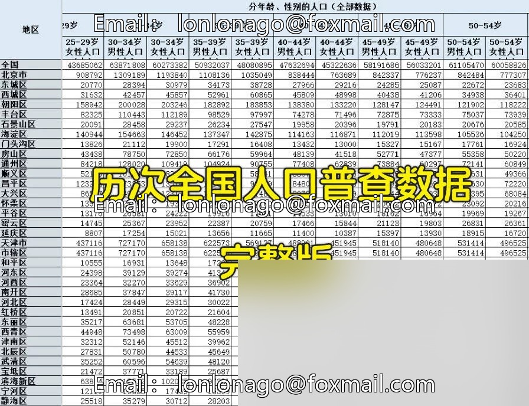
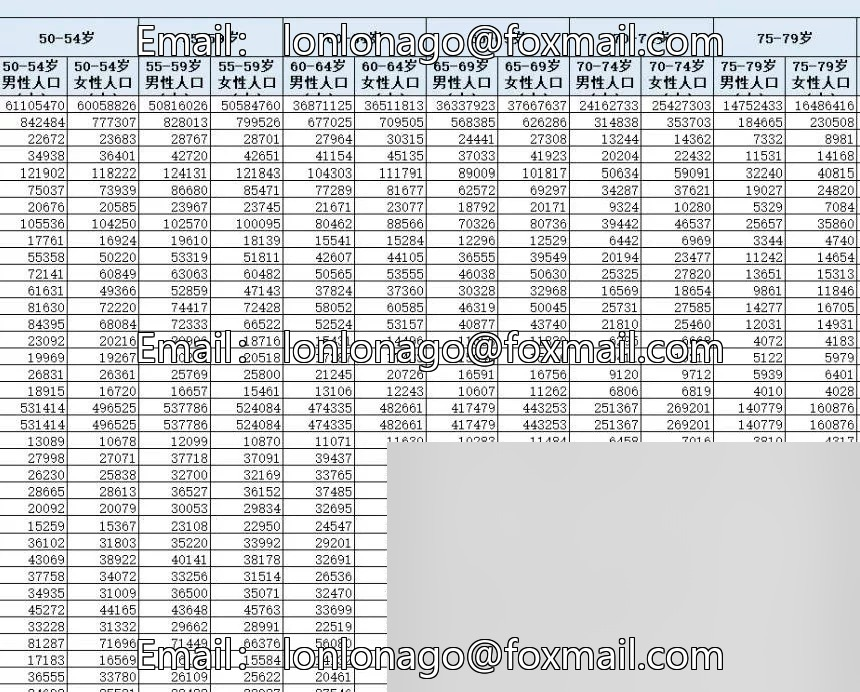
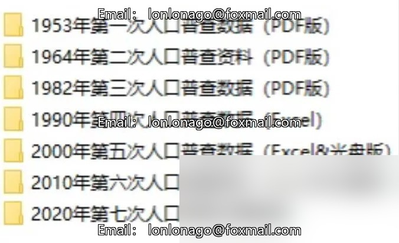

# Annual population census data from 1953 to 2020.

## Body

Data from each national population census from 1953 to 2020

1953 First population census data (PDF version)
1964 Second population census data (PDF version)
1982 Third population census data (PDF version)
1990 Fourth population census data (Excel)
2000 Fifth population census data (Excel)
2010 Sixth population census data (Excel)
2020 Seventh population census data (Excel)
The most recent national population census in China is 2020 (the seventh one).

web-based shipment, can be directly photographed and shipped.

The data covers all national population surveys from 1953 to 2020, including age and gender breakdowns, with specific records for various census types.

<!-- AI_ENRICHED -->

## Images

## Payment

Here is a pay link on Stripe ( https://buy.stripe.com/3cs8yP7sY87d0vu9AB ). Please contact me lonlonago@foxmail.com after funding $89, and I will send you a complete data files , thank you!

